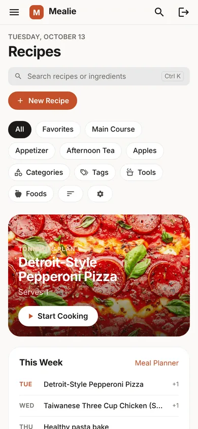
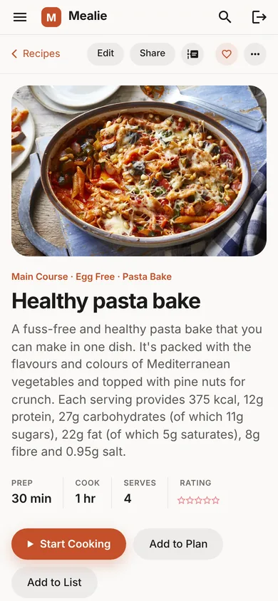

[![Latest Release][latest-release-shield]][latest-release-url]
[![Based on Mealie][upstream-version-shield]][upstream-url]
[![Last Commit][last-commit-shield]][last-commit-url]
[![Stargazers][stars-shield]][stars-url]
[![Forks][forks-shield]][forks-url]
[![Issues][issues-shield]][issues-url]
[![AGPL License][license-shield]][license-url]

<!-- PROJECT LOGO -->
<br />
<p align="center">
  <a href="https://github.com/TheShield2594/mealie">
<svg style="width:100px;height:100px" viewBox="0 0 24 24">
    <path fill="currentColor" d="M8.1,13.34L3.91,9.16C2.35,7.59 2.35,5.06 3.91,3.5L10.93,10.5L8.1,13.34M13.41,13L20.29,19.88L18.88,21.29L12,14.41L5.12,21.29L3.71,19.88L13.36,10.22L13.16,10C12.38,9.23 12.38,7.97 13.16,7.19L17.5,2.82L18.43,3.74L15.19,7L16.15,7.94L19.39,4.69L20.31,5.61L17.06,8.85L18,9.81L21.26,6.56L22.18,7.5L17.81,11.84C17.03,12.62 15.77,12.62 15,11.84L14.78,11.64L13.41,13Z" />
</svg>
  </a>

  <h3 align="center">Mealie, redesigned</h3>

  <p align="center">
    A Place For All Your Recipes, with a quieter, warmer web app
    <br />
    <a href="https://docs.mealie.io/"><strong>Explore the docs »</strong></a>
    <br />
    <a href="https://github.com/TheShield2594/mealie/releases">Releases</a>
    ·
    <a href="https://github.com/TheShield2594/mealie/issues">Report Bug</a>
    ·
    <a href="https://github.com/mealie-recipes/mealie">Upstream Mealie</a>
</p>

![Recipe library in the redesigned web app][screenshot-home]

# About This Fork

This is a fork of [Mealie](https://github.com/mealie-recipes/mealie), the self-hosted recipe manager, meal planner and shopping list. It tracks upstream **v3.28.0** and replaces the Material styling of the web app with a quieter, Apple-inspired design: a warm neutral palette, the system font and a terracotta accent, in light and dark mode.

The backend, API, database and import tools are upstream Mealie. Apart from the default theme colours, nothing behaves differently on the server, so existing data and integrations keep working.

## What's New in the Redesign

- **App shell:** a permanent sidebar on large screens with navigation, your cookbooks and the user menu. Smaller screens get a light frosted top bar. Press <kbd>Ctrl</kbd>/<kbd>⌘</kbd>+<kbd>K</kbd> or <kbd>/</kbd> to search.
- **Recipe library:** inline search, a New Recipe menu, one-tap category chips, a "Tonight's plan" hero and a "This Week" card from the meal planner, Recently Added, then the full recipe browser.
- **Recipe page:** photo and title side by side with prep, cook, servings and rating, plus Start Cooking, Add to Plan and Add to List. Ingredients have round checkboxes and a servings stepper, next to numbered method steps with timers picked up from the step text.
- **Cook mode:** a full-window dark screen that shows one large step at a time. It highlights the step's ingredients and has working countdown timers, a step list and an ingredients panel. Move between steps with the arrow keys or by swiping. The screen stays awake while you cook.
- **Everywhere else:** recipe editing, create and import, the meal planner, shopping lists, cookbooks, organizers, sign-in, settings and admin pages use the same page headers, rounded cards and pill buttons.
- **New default colours:** primary `#C4502A` (light) and `#E0683C` (dark). The `THEME_*` environment variables still override them.

## Screenshots

| Recipe page | Cook mode |
| --- | --- |
| ![Recipe page][screenshot-recipe] | ![Cook mode][screenshot-cook] |

| Meal planner | Shopping list |
| --- | --- |
| ![Meal planner][screenshot-mealplan] | ![Shopping list][screenshot-shopping] |

| New recipe | Dark mode |
| --- | --- |
| ![Recipe creation][screenshot-create] | ![Recipe library in dark mode][screenshot-dark] |

<p align="center">
  
  &nbsp;&nbsp;
  
</p>

## Key Features

Everything from upstream Mealie:

- Recipe imports: Create recipes by **importing from a URL** or entering data manually
- Meal Planner: Use the **Meal Planner** to plan what you'll cook for the next week
- Shopping List: Put the necessary ingredients on your **Shopping List**, organised into sections of your local supermarket
- Cookbooks: Group recipes into **Cookbooks** based on your own criteria
- Docker: Easy **Docker** deployment
- Localisation: **Translations** for 35+ languages

## Running This Fork

Each [release](https://github.com/TheShield2594/mealie/releases) publishes a Docker image for `linux/amd64` and `linux/arm64`:

```yaml
services:
  mealie:
    image: ghcr.io/theshield2594/mealie:v3.28.0-redesign.1 # or :latest
```

Follow the upstream [installation guide](https://docs.mealie.io/documentation/getting-started/installation/installation-checklist/) and swap in this image. Configuration, environment variables and backups work the same as upstream. The upstream images (`hkotel/mealie` and `ghcr.io/mealie-recipes/mealie`) run the original design, not this one.

### Custom logo

To replace the Mealie logo, put a square image named `logo.png` (or `logo.webp`/`logo.jpg`) of at least 512×512 pixels in a `branding` folder inside Mealie's data folder, e.g. `/app/data/branding/logo.png` in the container, and restart Mealie. It is used in the sidebar, the browser tab and for the app's home screen icon. A transparent background works best.

Remove the file and restart to go back to the default logo. Phones keep the home screen icon they installed with, so re-add the app to see a new one.

To build the image yourself instead:

```bash
git clone https://github.com/TheShield2594/mealie.git
cd mealie
docker build -f docker/Dockerfile -t mealie-redesign .
```

To run it for development, see the [Contributors Guide](https://nightly.mealie.io/contributors/developers-guide/code-contributions/). In short: `task setup`, then `task py` for the backend and `task ui` for the frontend.

## Versioning and Releases

Versions follow the upstream release they are based on, plus a redesign number: `v3.28.0-redesign.1` is the first release of the redesign on top of Mealie v3.28.0. The number resets when the fork is updated to a new upstream release. The Python package uses `3.28.0+redesign.1`, because Python versions can't contain `-redesign`.

The About page under Admin Settings checks this fork's releases, not upstream's, to tell you whether an update is available.

To cut a release:

1. Bump the version in a pull request: `task fork:version -- 3.28.0+redesign.2`
2. Once it is merged, create the tag on `mealie-next` in either of two ways:
   - On GitHub, open **Releases → Draft a new release**, type the new tag (`v3.28.0-redesign.2`), pick `mealie-next` as the target, generate the release notes and publish.
   - From a clone:
     ```bash
     git tag v3.28.0-redesign.2
     git push origin v3.28.0-redesign.2
     ```

The [Fork Release](.github/workflows/fork-release.yml) workflow then checks that the tag matches the version, runs the tests and publishes the image to `ghcr.io/theshield2594/mealie`. It then adds the image to the release notes, or creates the release with generated notes if you pushed only a tag.

<!-- CONTRIBUTING -->
## Contributing

Bugs in the redesigned UI belong in this fork's [issue tracker](https://github.com/TheShield2594/mealie/issues). Anything about Mealie's backend, importers or features in general is better raised [upstream](https://github.com/mealie-recipes/mealie/issues), where fixes reach everyone.

Translations are managed upstream on [Crowdin](https://crowdin.com/project/mealie). Only the `en-US` locale files are edited in this repository.

<!-- LICENSE -->
## License

Distributed under the AGPL License, the same as upstream Mealie. See `LICENSE` for more information.

## Credits

Mealie is created and maintained by [Hayden](https://github.com/hay-kot) and the [Mealie contributors](https://github.com/mealie-recipes/mealie/graphs/contributors). If Mealie is useful to you, consider supporting the original project through [GitHub Sponsors](https://github.com/sponsors/hay-kot) or [Buy Me a Coffee](https://www.buymeacoffee.com/haykot).

<!-- MARKDOWN LINKS & IMAGES -->
<!-- https://www.markdownguide.org/basic-syntax/#reference-style-links -->
[latest-release-shield]: https://img.shields.io/github/v/release/TheShield2594/mealie?style=flat-square&label=latest%20release
[latest-release-url]: https://github.com/TheShield2594/mealie/releases
[upstream-version-shield]: https://img.shields.io/badge/based%20on-Mealie%20v3.28.0-C4502A?style=flat-square
[upstream-url]: https://github.com/mealie-recipes/mealie
[last-commit-shield]: https://img.shields.io/github/last-commit/TheShield2594/mealie/mealie-next?style=flat-square
[last-commit-url]: https://github.com/TheShield2594/mealie/commits/mealie-next
[stars-shield]: https://img.shields.io/github/stars/TheShield2594/mealie.svg?style=flat-square
[stars-url]: https://github.com/TheShield2594/mealie/stargazers
[forks-shield]: https://img.shields.io/github/forks/TheShield2594/mealie.svg?style=flat-square
[forks-url]: https://github.com/TheShield2594/mealie/forks
[issues-shield]: https://img.shields.io/github/issues/TheShield2594/mealie.svg?style=flat-square
[issues-url]: https://github.com/TheShield2594/mealie/issues
[license-shield]: https://img.shields.io/github/license/TheShield2594/mealie.svg?style=flat-square
[license-url]: https://github.com/TheShield2594/mealie/blob/mealie-next/LICENSE
[screenshot-home]: docs/docs/assets/img/redesign/light-home.webp
[screenshot-dark]: docs/docs/assets/img/redesign/dark-home.webp
[screenshot-recipe]: docs/docs/assets/img/redesign/light-recipe.webp
[screenshot-cook]: docs/docs/assets/img/redesign/cook.webp
[screenshot-mealplan]: docs/docs/assets/img/redesign/light-mealplan.webp
[screenshot-shopping]: docs/docs/assets/img/redesign/light-shopping.webp
[screenshot-create]: docs/docs/assets/img/redesign/light-create.webp
